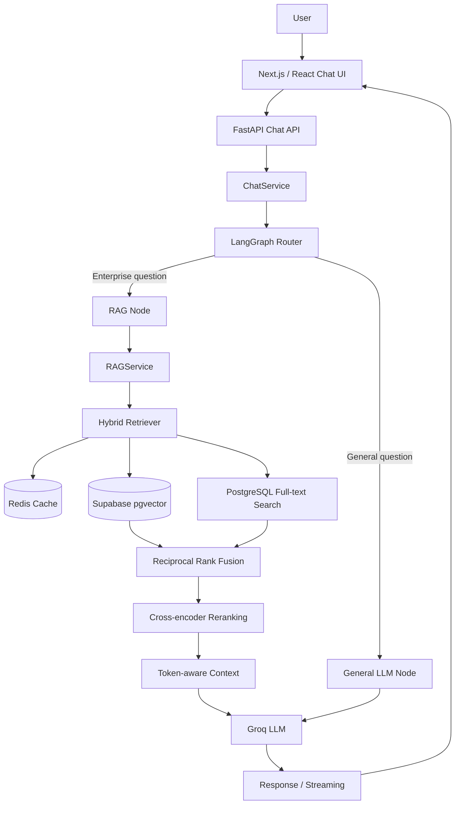
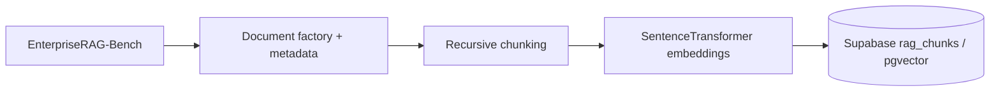

# Enterprise Knowledge Assistant (EKA)

**A full-stack, retrieval-augmented enterprise knowledge assistant with hybrid search, document reranking, LangGraph query routing, and streaming answers.**

Built as an engineering portfolio project to explore practical RAG system design: retrieval quality, source grounding, evaluation, observability, caching, resilience, and interactive LLM applications.

> **Project scope:** EKA v1 is a knowledge Q&A application using a synthetic enterprise benchmark. It is not a production-deployed, authenticated multi-tenant knowledge system. Features such as autonomous tool calling, persistent conversation memory, and LangGraph checkpointing are intentionally outside the current scope.

## Features

- **Document ingestion:** Stream records from the `onyx-dot-app/EnterpriseRAG-Bench` Hugging Face dataset, create LangChain documents, and split content into overlapping chunks.
- **Local embeddings:** Generate 384-dimensional vectors using `sentence-transformers/all-MiniLM-L6-v2`.
- **Vector storage:** Index document chunks and metadata in Supabase PostgreSQL/pgvector.
- **Hybrid retrieval:** Combine vector similarity search and PostgreSQL full-text search with Reciprocal Rank Fusion (RRF).
- **Cross-encoder reranking:** Rerank retrieved candidates before assembling the response context.
- **Grounded generation:** Construct a token-budgeted context and request answers based on retrieved evidence, with a no-context fallback.
- **Graph orchestration:** Use LangGraph to route questions to either a RAG node or a general LLM node.
- **Streaming UI:** Stream generated content through FastAPI to a Next.js/React client.
- **Resilience and observability:** Include request IDs, logging, retrieval retries/timeouts, circuit breaker logic, rate limiting, and Redis-backed caches.
- **Evaluation framework:** Include retrieval metrics (Precision@K, Recall@K, Hit Rate@K, reciprocal rank) and generation assessment (faithfulness and answer relevancy through an LLM-as-judge approach).

## System architecture



The diagram is a logical overview: retrieval caching wraps operations in the retriever, and the vector and keyword results are combined before reranking. The graph's two actual routes are **RAG** and **GENERAL**; it does not currently include a tool-agent route.

### Ingestion pipeline



The loader reads the dataset's `documents` configuration, `test` split, with streaming enabled. Ingestion is limited to a configurable number of records per run; it does **not** automatically index the entire dataset.

## Technology stack

| Layer | Technology |
| --- | --- |
| Web client | Next.js 16, React 19, TypeScript, Tailwind CSS |
| API | Python 3.14+, FastAPI, Pydantic settings |
| Graph orchestration | LangGraph |
| LLM provider | Groq API (model selected through `LLM_MODEL`) |
| Embeddings | Sentence Transformers / `all-MiniLM-L6-v2` |
| Retrieval | PostgreSQL full-text search, Supabase pgvector, RRF |
| Reranking | Sentence Transformers cross-encoder |
| Caching | Redis (with cache-layer failure handling) |
| Developer tooling | `uv`, Ruff, pytest, GitHub Actions |

## Repository layout

```text
enterprise-knowledge-assistant/
├── apps/
│   ├── api/
│   │   ├── app/
│   │   │   ├── agents/eka/           # LangGraph graph, state and nodes
│   │   │   ├── api/v1/endpoints/     # Chat and health endpoints
│   │   │   ├── cache/                # Cache abstractions and Redis integration
│   │   │   ├── dependencies/         # Service construction and wiring
│   │   │   ├── integrations/llm/     # Groq client
│   │   │   ├── middleware/           # Rate limit and request ID
│   │   │   ├── prompts/              # Chat, RAG and router prompts
│   │   │   ├── rag/                  # Ingestion, indexing, retrieval,
│   │   │   │                         # reranking, evaluation, tokenization
│   │   │   └── services/             # ChatService and LLMService
│   │   ├── tests/
│   │   └── pyproject.toml
│   └── web/
│       ├── app/
│       │   └── features/chat/        # Chat UI and API client
│       └── package.json
└── .github/workflows/backend-quality.yml
```

## Getting started

### Prerequisites

- Python **3.14+**, `uv`, Node.js compatible with the pinned Next.js release, and npm.
- A Groq API key and an available model configured for the Groq API.
- A Supabase project with pgvector enabled, the expected `rag_chunks` table, and SQL/RPC functions used by the vector store.
- A Redis instance, or an appropriate local configuration for the cache integration.

> **Database setup note:** The repository contains Python calls to `rag_chunks`, `match_rag_chunks`, and `keyword_search_rag_chunks`, but no checked-in SQL migrations were identified in the reviewed repository tree. You must provision compatible database objects before RAG retrieval works. Their exact SQL definitions are not included here because they cannot be reconstructed safely from the client code alone.

### Backend

From the repository root:

```bash
cd apps/api
uv sync --dev
```

Create the repository-root `.env` file (the settings code resolves this location from `apps/api/app/core/config.py`). Add your own values:

```dotenv
GROQ_API_KEY=your_groq_key
LLM_MODEL=your_supported_groq_model
SUPABASE_URL=https://your-project.supabase.co
SUPABASE_KEY=your_supabase_key
REDIS_URL=redis://localhost:6379/0
FRONTEND_URL=http://localhost:3000
RAG_MAX_TOKENS=2000
```

**Never commit real API keys or database credentials.** Keep Supabase privileged credentials on the backend only. Verify the model configured in `LLM_MODEL` is actually supported by your Groq account; the default value shown in the current settings source is not a reliable Groq model choice.

Run the API:

```bash
uv run uvicorn app.main:app --reload
```

FastAPI interactive docs: `http://localhost:8000/docs`.

### Frontend

In a second terminal:

```bash
cd apps/web
npm ci
```

Create `apps/web/.env.local`:

```dotenv
NEXT_PUBLIC_API_BASE_URL=http://localhost:8000/api/v1
```

Start the UI:

```bash
npm run dev
```

Open `http://localhost:3000`.

**Ingestion:** The dataset ingestion/indexing pipeline is implemented in `app/rag/indexing/indexing_service.py`. It is not currently exposed as a supported public CLI command. Run ingestion through an explicitly configured local script or Python invocation after provisioning the required Supabase schema; do not assume the API automatically seeds documents on startup.

## HTTP API

The FastAPI routes are registered under `/api/v1`.

| Method | Route | Purpose |
| --- | --- | --- |
| GET | `/health` | API health-check response |
| GET | `/chat` | Basic chat service status/demo |
| POST | `/chat/response` | Non-streaming RAG response |
| POST | `/chat/stream` | Streaming RAG response (`text/plain`) |
| POST | `/chat/langgraph/response` | LangGraph-routed response |
| POST | `/chat/langgraph/stream` | LangGraph-routed streaming response (`text/plain`) |

Example:

```bash
curl -X POST http://localhost:8000/api/v1/chat/langgraph/response \
  -H 'Content-Type: application/json' \
  -d '{"message":"What should be checked before a first production launch?"}'
```

The current frontend's send action uses the LangGraph streaming endpoint. Response streaming is exposed as **plain text** at the API layer; the backend uses LangGraph update/custom events internally.

## Sample questions

**Enterprise knowledge (RAG route)**

- What evidence is required before an application's first production launch?
- How should network connectivity be validated for a private deployment?
- What should be checked when troubleshooting NAT or egress exhaustion?
- What steps should be followed when investigating an enterprise billing dispute?

**General knowledge (GENERAL route)**

- What is Retrieval-Augmented Generation?
- Explain how a circuit breaker works in distributed systems.

Answers to enterprise questions depend on which benchmark documents have actually been indexed in your Supabase database.

## Evaluation approach

The repository contains a small ground-truth evaluation set and implementations for:

- **Precision@K, Recall@K, Hit Rate@K and reciprocal rank:** Compare retrieved document identifiers with expected supporting documents.
- **Faithfulness:** Use an LLM-as-judge to evaluate whether claims in a generated answer are supported by retrieved context.
- **Answer relevancy:** Use an LLM-as-judge to evaluate whether an answer addresses the question.

These are **evaluation methods**, not published performance results. This README intentionally does not claim benchmark scores because no independently verified aggregate results were available in the reviewed repository. Document IDs in the ground-truth set must be present in the indexed corpus for meaningful retrieval evaluation.

## Quality checks

Backend:

```bash
cd apps/api
uv run ruff format --check .
uv run ruff check .
uv run pytest -q
```

Frontend:

```bash
cd apps/web
npm run lint
npm run build
```

The GitHub Actions workflow in `.github/workflows/backend-quality.yml` checks backend formatting and linting on matching pull requests. These checks do not replace end-to-end, security, or performance testing.

## Architecture decisions and trade-offs

| Decision | Rationale | Trade-off |
| --- | --- | --- |
| Hybrid search + RRF | Combines semantic and keyword retrieval signals | More retrieval work than vector-only search |
| Cross-encoder reranking | Improves relevance ordering before generation | Adds inference latency |
| Local embeddings | Avoids embedding-provider calls during local experimentation | Requires local compute and model setup |
| Redis retrieval cache | Reduces repeated retrieval/embedding effort | Requires cache keys, TTLs, and invalidation decisions |
| LangGraph router | Keeps RAG-specific and general-answer paths explicit | Adds a classification step and orchestration code |
| Token-aware context building | Limits injected context size | Large chunks can be skipped under the budget |
| No agentic tool loop in v1 | Core requirement is knowledge Q&A, already served by RAG + GENERAL | Cannot autonomously invoke arbitrary external enterprise APIs |
| No persistent conversation state | Single-turn Q&A keeps the scope focused | Follow-up questions cannot reliably depend on previous turns |

## Security and current limitations

- The sample data is synthetic. **Authentication, user-specific resource authorization, and tenant isolation are not implemented as complete production controls.**
- Department-aware retrieval parameters exist in the retrieval layer, but the public chat flow does not establish verified user-scoped authorization for them.
- Grounding instructions in a prompt are not a substitute for robust prompt-injection defenses or verified factual correctness.
- The current LangGraph graph has two routes only (`RAG`, `GENERAL`); it has no tool-execution loop, persistent memory, or checkpointer.
- Redis caching and the rate limiter require further deployment-specific concurrency and security review.
- External dependencies (Groq, Supabase, Redis, Hugging Face model downloads) must be available and configured for end-to-end operation.
- The UI is an engineering demonstration interface rather than a polished production product.
- This repository is a learning/portfolio implementation; do not use it for sensitive internal enterprise data without additional security and operational controls.

## Suggested future work

- Authenticated, user-scoped retrieval and stronger prompt-injection defenses.
- Repeatable evaluation reports with baseline/threshold tracking.
- Automated integration tests, deployment manifests, and end-to-end CI.
- Structured response metadata with verifiable source references and confidence handling.
- Persistent memory/checkpointing **only** if the application's future requirements include multi-turn conversation or resumable workflows.

## Project status

**EKA v1 feature scope:** Advanced RAG + LangGraph-routed Q&A and streaming.

**Documentation/release:** Final README prepared for review. A `v1.0.0` release should be tagged only after the documentation PR is merged and final verification is complete.

---

Maintained by [vivekkasturi](https://github.com/vivekkasturi). Contributions and engineering discussions are welcome through GitHub issues and pull requests.